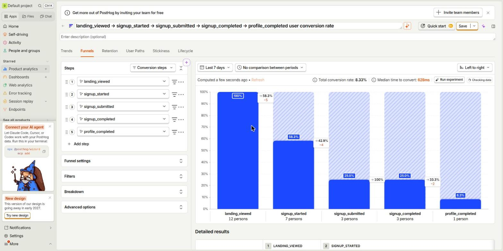

# Analytics plan

The business question is one number: of the people marketing sends here, how many create an
account. Everything below exists to make that number correct, and to explain it when it moves.

The three tables in this document are generated from the code (`npm run gen`), so they cannot
drift from what the page sends: `src/lib/analytics/registry.ts` is the single source.

## Funnel

| Step | Event | Recorded by |
|---|---|---|
| Entry | `landing_viewed` | browser |
| Intent, where the hero has a button | `cta_clicked` | browser |
| Started the form | `signup_started` | browser |
| Sent it | `signup_submitted` | browser |
| **Primary conversion: the account exists** | `signup_completed` | **server, after the commit** |
| Secondary: told us how they trade | `profile_completed` | server |

`signup_failed` is not a step. It explains the gap between "sent it" and "the account
exists", by reason. `web_vitals` and `experiment_exposed` are context for the funnel: whether
the page was fast for the people in it, and which arm they saw.

## Primary conversion metric

**Signup conversion rate:** visitors with a `signup_completed` within 7 days of their first
`landing_viewed`, divided by visitors with a `landing_viewed`.

- The unit is the visitor (the anonymous id), not the session or the page view.
- Split by first-touch source, device class and experiment arm.
- In an experiment the denominator is `experiment_exposed`, which the server records, so both
  sides of the ratio are immune to blocked scripts ([experiment plan](experiments/hero_signup.md)).
- "Account" here means a user row. FX Replay's own `signup_step_completed` fires later, after
  the plan choice, so the two are not the same number
  ([ADR 0013](decisions/0013-event-taxonomy-and-primary-metric.md)).

## Events

Each event names the decision it informs. One that informs none is removed.

<!-- events:start -->
<!-- Generated from src/lib/analytics/registry.ts by `npm run gen`. Do not edit: change the registry and run the command. -->

| Event | Fires | Trigger | Properties | Decision it informs |
| --- | --- | --- | --- | --- |
| `landing_viewed` | browser | Once per page load, after the landing page has rendered in a browser. | none | The denominator of the funnel: whether traffic from a source is worth buying. |
| `cta_clicked` | browser | A visitor activates a call to action that leads to the signup form. | `cta_name`: `start_free`<br>`cta_location`: `hero`, `proof`, `plan`, `faq`, `closing` | Which calls to action earn their place on the page. |
| `signup_started` | browser | The first input into the email field, once per page load. | `form_location`: `hero`, `closing` | Whether visitors are lost before the form (interest) or in it (friction). |
| `signup_submitted` | browser | The form passes client validation and a create request is sent. | `form_location`: `hero`, `closing`<br>`attempt`: integer, 1 to 50 | How many attempts never become accounts. |
| `signup_failed` | browser | A submission ends in anything other than an account, including client validation. | `form_location`: `hero`, `closing`<br>`attempt`: integer, 1 to 50<br>`reason`: `invalid_email`, `email_taken`, `rate_limited`, `offline`, `timeout`, `network`, `server`, `unexpected` | Which failure to fix first, and whether a release broke the signup. |
| `signup_completed` | server | The user row has been committed. Not emitted for an idempotent replay. | `user_id`: opaque id | The primary conversion. The numerator of the signup conversion rate. |
| `profile_completed` | server | A profile update that leaves at least one answer has been saved. | `user_id`: opaque id<br>`markets_count`: integer, 0 to 5<br>`experience`: `beginner`, `intermediate`, `advanced`, optional<br>`goal`: `strategy_testing`, `prop_firm`, `practice`, optional | Signup quality: the guardrail that stops a variant winning with empty accounts. |
| `experiment_exposed` | server | The edge serves a variant of the page to a visitor, before the HTML is sent. | `experiment`: opaque id<br>`variant`: opaque id | The denominator of each arm, and the sample-ratio check that validates a run. |
| `web_vitals` | browser | A Core Web Vital is final for this page load: once per metric. | `metric`: `LCP`, `INP`, `CLS`<br>`value`: number, 0 to 600000<br>`rating`: `good`, `needs-improvement`, `poor` | Whether real visitors get the page the lab budgets promise, by device and variant. |

<!-- events:end -->

## Context on every event

Call sites pass only an event's own properties. The tracker and the server attach the rest.

<!-- context:start -->
<!-- Generated from src/lib/analytics/registry.ts by `npm run gen`. Do not edit: change the registry and run the command. -->

| Field | Type | Meaning |
| --- | --- | --- |
| `event_id` | opaque id | Unique per event, for deduplication. |
| `occurred_at` | ISO 8601 timestamp, UTC | When it happened, ISO 8601 in UTC. |
| `anonymous_id` | opaque id | The visitor: a first-party cookie set at the edge. |
| `session_id` | opaque id, optional | The visit: ends after 30 minutes without activity. Browser events only. |
| `page_path` | site path, optional | The page, without query string. |
| `device_class` | `mobile`, `tablet`, `desktop`, optional | From the viewport width at page load. |
| `release` | opaque id | The git SHA of the build that emitted it. |
| `experiments` | `key:variant` pairs, comma-separated, optional | The variant of every running experiment, as `key:variant` pairs. |
| `first_source` | label (lowercase slug), optional | First touch: utm_source. |
| `first_medium` | label (lowercase slug), optional | First touch: utm_medium. |
| `first_campaign` | label (lowercase slug), optional | First touch: utm_campaign. |
| `last_source` | label (lowercase slug), optional | Last touch: utm_source. |
| `last_medium` | label (lowercase slug), optional | Last touch: utm_medium. |
| `last_campaign` | label (lowercase slug), optional | Last touch: utm_campaign. |
| `via` | label (lowercase slug), optional | The affiliate token, from ?via=. |
| `aff` | label (lowercase slug), optional | The source tag, from ?aff=. |
| `source` | `client`, `server`, optional | Where the event was emitted. Set by the server, never by the browser. |
| `country` | label (lowercase slug), optional | Two-letter country of the request, from the edge. Set by the server. |
| `is_bot` | boolean, optional | The user agent looks automated. Set by the server, to filter in analysis. |

<!-- context:end -->

## Architecture and tooling

```
browser                         our origin (Cloudflare Worker)            destination
───────                         ──────────────────────────────            ───────────
track(name, props) ──batch──▶  POST /api/events  (the collector)
  typed by the registry          checks every event against the registry
  no vendor script               refuses server-only events        ──▶  PostHog (capture API)
                                 adds visitor id, country, bot flag
dataLayer.push(...)             GET /        ──▶ experiment_exposed ──▶
  for ad platforms              POST /api/users ─▶ signup_completed ──▶
                                PATCH /api/users/… ▶ profile_completed ─▶
```

- **One registry, three uses:** the types that make `track()` refuse an unknown event or
  property at compile time, the validation the collector runs on every event, and the tables
  above.
- **No vendor script on the page.** The tracker (2.4 KB gzipped) posts to our own origin, and
  the Worker forwards to PostHog after the response is sent
  ([ADR 0014](decisions/0014-first-party-event-collector.md)). In production at FX Replay the
  forwarder would point at their existing first-party pipeline.
- **The visitor id is an `HttpOnly` cookie the server sets and reads.** Scripts never see it.
  The same id is stored with the user at signup, so analytics and the database join.
- **PostHog** is the destination for analysis: funnels, breakdowns, experiment readouts. A
  `dataLayer` push per event is there for ad platforms. No tag manager is loaded in this demo.
- **With no PostHog key** the collector still validates and then discards, so the site and
  its tests run without any account.

## Data quality

How the number is kept accurate and trustworthy, in the order a failure would be caught:

| Risk | What prevents or detects it |
|---|---|
| A typo in an event or property name | It does not compile: `track()` is typed from the registry |
| A property with the wrong shape at runtime | The collector validates every event and drops what does not fit |
| Personal data in a payload | The registry has no free-text type, unknown keys are dropped at the collector, and campaign parameters are forced into lowercase labels that cannot contain "@". A test sends an email in every place it could hide and asserts it never leaves |
| The conversion lost to an ad blocker | It is emitted by the server after the row is committed, not by the browser |
| A conversion counted twice | It is not emitted for an idempotent replay, and every event carries an `event_id` to deduplicate on |
| A forged conversion | The collector refuses `signup_completed`, `profile_completed` and `experiment_exposed` from a browser |
| The funnel firing twice or out of order | An end-to-end test drives the real page and asserts the browser events once, in order, with their properties |
| The analytics count drifting from reality | Reconciliation: `signup_completed` events per day against rows in `users` per day. The users table is the truth. A gap above 1% is an incident |
| Bots and internal traffic | Events from automated agents are flagged `is_bot` and excluded in analysis, not silently dropped. Internal traffic is excluded by source tag |
| A broken split in an experiment | A sample-ratio check on exposed visitors per arm, before any result is read (`scripts/experiment/stats.mjs`) |
| A visitor counted twice | Cleared cookies create a new visitor. Accepted, and it biases a comparison toward zero |
| Wrong timestamps | A browser's clock is trusted within a day. Outside that, the server's time is used |
| A regression nobody notices | Every event carries the release SHA, so a change in the funnel points at a deploy |

## Experiments

<!-- experiments:start -->
<!-- Generated from src/lib/experiments/registry.ts by `npm run gen`. Do not edit: change the registry and run the command. -->

| Key | Control | Variants | Status | Plan |
| --- | --- | --- | --- | --- |
| `hero_signup` | `cta_button` | `cta_button`, `inline_email` | running | [experiments/hero_signup.md](experiments/hero_signup.md) |

<!-- experiments:end -->

## Seen working end to end

On 2026-11-19 nine scripted visits ran against the deployed site, tagged as internal traffic
(`aff=internal`), each stopping at a different step. The events went from the browser to the
collector on Cloudflare and on to PostHog, and the funnel below is PostHog's own, built from
them. The server events (`experiment_exposed`, `signup_completed`, `profile_completed`)
arrived with the same visitor id as the browser events of the same visit, which is what lets
the funnel join them. The visit that submitted a malformed email produced a `signup_failed`
and no `signup_submitted`, as designed.



This is test traffic, not a measurement of anything: the numbers show that the pipeline
counts, not how the page converts. The other visitors in the first step are automated
audits of the live page.

## What is not verified yet

- The reconciliation of `signup_completed` against the `users` table is defined above and
  not automated.
- The country and bot fields were not inspected in PostHog event by event.
- No real visitor has seen the page, so every rate in this document is a definition, not a
  result.
